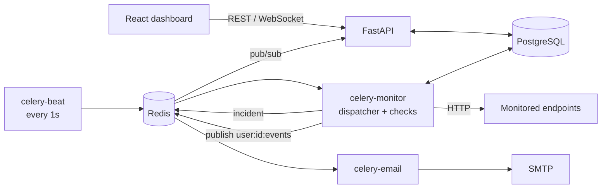

# PulseWatch

[](https://github.com/ArtmShtv/PulseWatchServiceBackend/actions/workflows/tests.yml)

Uptime monitoring backend. Users register HTTP endpoints; background workers check them
on a schedule, store the check history, open and resolve incidents, send email alerts
and push live updates to the dashboard over WebSocket.

## Features

- JWT auth (access + refresh tokens), argon2 password hashing, login rate limiting
- Monitors: URL, method (GET/HEAD), interval, timeout, expected status code
- Scheduled checks with Celery: a dispatcher picks due monitors every second
  (`FOR UPDATE SKIP LOCKED`, so several dispatchers never double-schedule)
- Incidents open on the first confirmed failure and resolve on recovery;
  email notification on a separate queue
- Live updates: workers publish to Redis pub/sub, the API forwards events to the
  user's WebSocket connections
- SSRF protection: monitors can't target localhost, private networks or cloud metadata,
  including through redirects
- Alembic migrations checked in CI (upgrade, `alembic check`, downgrade, upgrade)

## Architecture



1. `celery-beat` queues `dispatch_due_monitors` every second.
2. The dispatcher locks due monitors (`SKIP LOCKED`), moves `next_run_at` forward in one
   `UPDATE ... RETURNING`, commits, then queues one `check_endpoint` per monitor.
3. `check_endpoint` reads the monitor, releases the DB connection, probes the URL
   (one confirm retry on failure), then saves the check and opens/resolves the incident
   under a row lock.
4. After the commit it publishes an event to Redis; the API's subscriber forwards it
   to that user's WebSocket clients. New incidents also go to the `emails` queue.

## Stack

Python 3.12 · FastAPI · SQLAlchemy 2.0 (asyncpg in the API, psycopg2 in workers) ·
PostgreSQL 17 · Alembic · Celery + Redis · PyJWT · pwdlib (argon2) · pytest · ruff ·
uv · Docker Compose · GitHub Actions

## Quick start (Docker)

```bash
cp .env.example .env          # fill in SECRET_KEY, Postgres, Redis password, SMTP
docker compose up --build
```

- API: http://localhost:8000, Swagger UI: http://localhost:8000/docs
- Migrations run automatically (`migrate` service) before the API and workers start.
- `REDIS_PASSWORD` is required - Redis starts with `--requirepass`.

## Local development

```bash
uv sync                                   # install dependencies (incl. dev tools)
docker compose up -d postgres redis       # only the databases
uv run alembic upgrade head
uv run uvicorn app.main:app --reload
```

`.env` holds values for running code **on your machine** (`POSTGRES_HOST=localhost`,
`REDIS_HOST=localhost`). Inside containers, docker-compose overrides them with the
service names `postgres` and `redis`, which only resolve inside the Compose network.

## Tests

Tests run against a separate Postgres (port 5433, data in tmpfs):

```bash
# .env.test needs TESTS_POSTGRES_* and REDIS_PASSWORD (compose checks it for every service)
docker compose --env-file .env.test --profile test up -d db_test
uv run pytest -v
uv run ruff check .
```

Each test runs inside a transaction that is rolled back, so tests don't affect each other.

## Migrations

```bash
uv run alembic revision --autogenerate -m "describe the change"   # then review the file!
uv run alembic upgrade head
uv run alembic check
```

See [docs/alembic-migrations.md](docs/alembic-migrations.md) for the full workflow,
what autogenerate misses and safe production patterns.

## API

| Method | Path | Description |
|---|---|---|
| POST | `/users/register` | Create a user (201) |
| POST | `/users/login` | JSON login -> access + refresh token (rate limited) |
| POST | `/users/token` | Form login for the Swagger "Authorize" button (email in `username`) |
| POST | `/users/refresh` | New access token from a refresh token |
| GET | `/monitors/` | List your monitors |
| POST | `/monitors/` | Create a monitor (201) |
| GET | `/monitors/{id}` | Get a monitor |
| PATCH | `/monitors/{id}` | Update a monitor |
| DELETE | `/monitors/{id}` | Delete a monitor (204) |
| WS | `/ws?token=<access_token>` | Live events for your monitors |
| GET | `/health` | Liveness check |

WebSocket events are JSON: `{"type", "monitor_id", "ts", "data"}` with types
`connected`, `ping`, `check.completed`, `incident.opened`, `incident.resolved`.

## Security notes

- **SSRF:** the API rejects `localhost` and private IP literals; the worker resolves every
  hostname (and every redirect target) and refuses non-public addresses.
  `ALLOW_PRIVATE_TARGETS=true` disables this for local experiments only.
- **Brute force:** `/users/login` and `/users/token` allow `LOGIN_RATE_LIMIT` attempts per
  client IP per `LOGIN_RATE_WINDOW_SECONDS` (default 10 per minute), stored in Redis.
  Behind a reverse proxy, run uvicorn with `--proxy-headers --forwarded-allow-ips=<proxy ip>`
  so the limit applies per real client, not per proxy.
- Login errors are identical for unknown email and wrong password, and the password hash
  is checked in both cases (no user enumeration through timing).

## Project structure

```
app/
  api/routes/   HTTP layer: validate input, call a service, map errors to status codes
  services/     business logic (auth, monitors, event publishing)
  core/         settings, security (JWT, hashing), URL safety, rate limiting, exceptions
  db/           models, async engine (API), sync engine (Celery)
  schemas/      Pydantic request/response models
  tasks/        Celery app, dispatcher, check and email tasks
  ws/           WebSocket endpoint, connection manager, Redis subscriber
alembic/        migrations
tests/          pytest suite
docs/           guides
```

## Roadmap

- Check and incident history endpoints (paginated), pause/resume monitors
- Prometheus metrics, Grafana dashboard, structured logs
- Reverse proxy with TLS, image build and deploy pipeline, live demo
